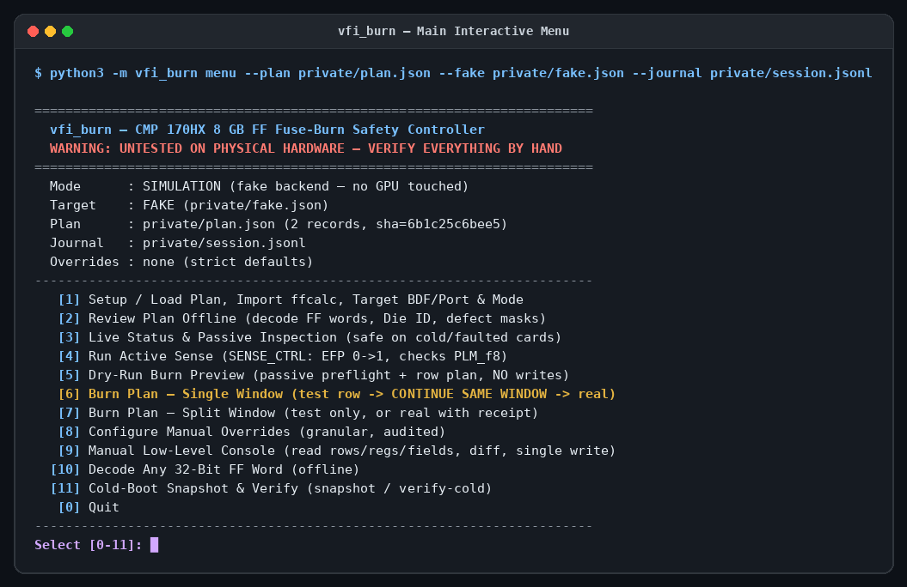
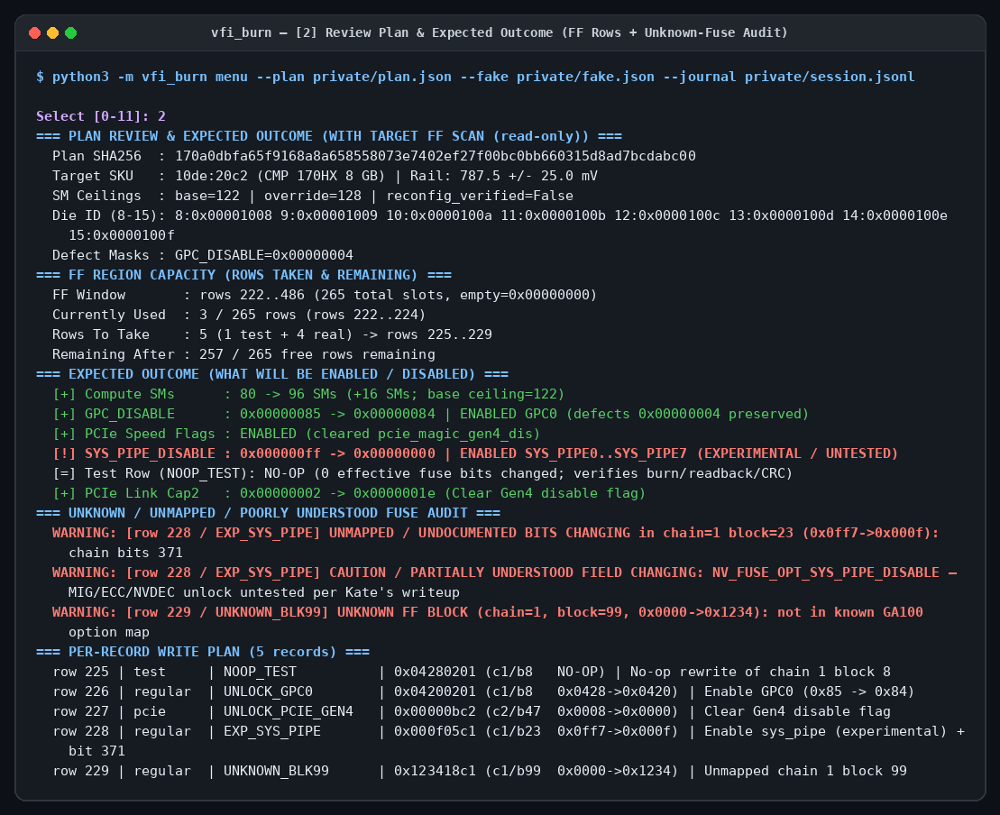
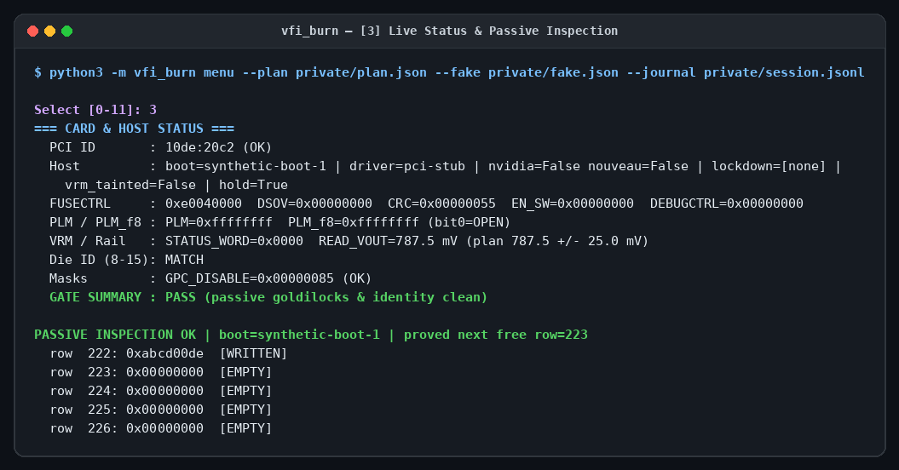
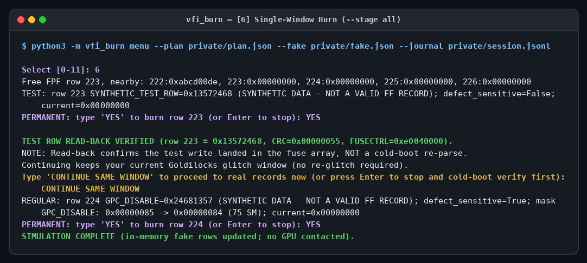
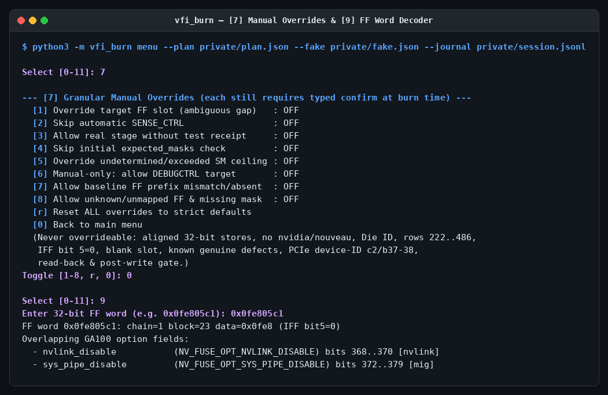
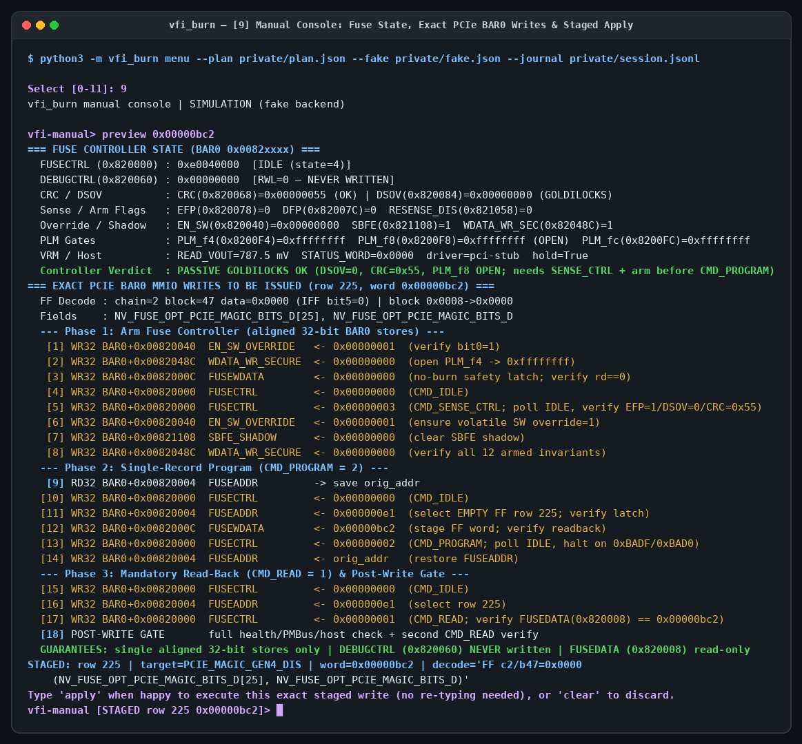

# vfi_burn — CMP 170HX 8 GB FF Fuse-Burn Safety Controller

> [!CAUTION]
> **UNTESTED ON PHYSICAL HARDWARE — THIS TOOL HAS NEVER BEEN USED TO BURN A REAL GPU YET.**
>
> **Do not treat this as battle-tested software.** Every test in this repository runs offline against synthetic in-memory mocks (`FakeController` / `FakeGA100MMIO`). Passing the test suite proves control flow and safety-gate logic only — **it does NOT prove real silicon behavior**.
>
> Fuse programming is **physically irreversible**, and the worst-case failure is a **permanently bricked card**. Treat your first real run as untested code:
> - Inspect everything read-only first (`plan`, `inspect`, `manual status/read-rows`).
> - Cross-check every decoded FF word, row number, and defect mask by hand against independent tools (`cmp170hx-ffcalc` / `ga100-ff-tools`).
> - Always burn a single **no-op test row** (`--prepend-noop-test`) first and verify read-back + `CRC=0x55` before burning real unlock records (you can either continue in the **same Goldilocks window** with `--stage all` so you don't lose a hard-won glitch, or split across a cold boot with `--stage test` / `--stage real`).
> - Use entirely at your own risk.

---

## Overview

`vfi_burn` is a standalone Python 3.10+ (standard library only, zero third-party dependencies) fail-closed safety controller for programming GA100 Fuseless Fuse (FF) records on the **NVIDIA CMP 170HX 8 GB (`10de:20c2`)**.

It sits downstream of:
- your **voltage-glitch / hold setup** (e.g. [`dalzyu/pico-ga100vfi`](https://github.com/dalzyu/pico-ga100vfi), [`darkmaniac7/cmp170hx-8gb-vfi-tools`](https://github.com/darkmaniac7/cmp170hx-8gb-vfi-tools)) — `vfi_burn` never glitches, dips NVVDD, or pulses `PEX_RST`;
- your **offline floorplan / fuse planner** (e.g. [`sayhellotojungle/cmp170hx-ffcalc`](https://github.com/sayhellotojungle/cmp170hx-ffcalc), [`kprinssu/ga100-ff-tools`](https://github.com/kprinssu/ga100-ff-tools)) — `vfi_burn` can directly import `cmp170hx-ffcalc` plans and independently decode/verify every FF word.

Design philosophy (see [`BURN_SPEC.md`](BURN_SPEC.md)):
- **Passive dry-run by default**: `vfi_burn burn` performs passive preflight and slot proving without firing active sense or programming fuses unless you explicitly opt in (`--sense` / `--execute`).
- **One record at a time, mandatory read-back**: no batching, no automatic retries, and the row pointer never advances until both read-back and the full post-write health/PMBus/host gate pass.
- **Full audit trail**: every read, preflight/sense pass or failure, override, confirmation, write attempt (`fsync`ed *before* touching hardware), halt, and cold verification is appended to an exclusively locked (`flock`), mode-`0600` JSONL journal.
- **Granular manual overrides, never a blanket `--force`**: bench edge cases have explicit, loud, double-confirmed, journaled overrides while hard brick-prevention invariants remain unbreakable.

---

## GA100 Hardware Protocol & Sources

The register map, FF binary format, and Goldilocks arming/programming sequences implemented in [`vfi_burn/ffrecord.py`](vfi_burn/ffrecord.py), [`vfi_burn/ga100.py`](vfi_burn/ga100.py), and [`vfi_burn/mmio.py`](vfi_burn/mmio.py) were cross-checked across public GA100 VFI research (again, **not yet run on real hardware by this codebase**):

- [Kate Land — *Using voltage glitching to unleash the A100 in my mining card*](https://blog.kate.land/posts/using-voltage-glitching-to-unlock-the-a100/)
- [`sayhellotojungle/cmp170hx-ffcalc`](https://github.com/sayhellotojungle/cmp170hx-ffcalc)
- [`kprinssu/ga100-ff-tools`](https://github.com/kprinssu/ga100-ff-tools)
- [`darkmaniac7/cmp170hx-8gb-vfi-tools`](https://github.com/darkmaniac7/cmp170hx-8gb-vfi-tools)
- [`dalzyu/pico-ga100vfi`](https://github.com/dalzyu/pico-ga100vfi)

Key protocol details implemented:
- **FF Record Encoding**: `word = (data16 << 16) | (block10 << 6) | chain5`, with **bit 5 (`IFF`) strictly `0`**. Later records for the same `(chain, block)` override earlier records.
- **FF Row Bounds & Empty Marker**: rows **`222..486`** only (rows `0..221` control/regular/FPF and `487..511` IFF are hard-refused). Blank rows read **`0x00000000`** via `CMD_READ`.
- **Burn Voltage**: on-die programming at **stock parked NVVDD (~787.5 mV)** under PMBus control; no external elevated voltage is used.
- **Single Aligned 32-Bit MMIO Stores**: [`AlignedMMIO`](vfi_burn/mmio.py) uses `memoryview(mm)[off:off+4].cast("I")[0] = value` (patch 0012 — never `struct.pack_into`, which zeroes the register first). `DEBUGCTRL (0x00820060)` is never written (must read `0`, `RWL=0`).
- **Goldilocks Arming (`SENSE_CTRL`)**:
  1. `EN_SW_OVERRIDE (0x820040) = 1` (sticks only while `DSOV = 0`) and `WDATA_WR_SECURE (0x82048C) = 0` (`PLM_f4` opens to `0xFFFFFFFF`).
  2. Verify `RESENSE_DISABLE (0x821058) == 0`, clear `IFF_RECORD (0x820050)` if nonzero, and latch **no-burn safety guard** `FUSEWDATA (0x82000C) = 0` (readback verified).
  3. Write `FUSECTRL = 0 (IDLE)` → `FUSECTRL = 3 (SENSE_CTRL)`, poll `IDLE` (state=4). Verify `EFP (0x820078) == 1`, `DSOV == 0`, `CRC == 0x55`, `DFP (0x82007C) == 0`, `PLM_f8` bit 0 open. Idempotent when `EFP == 1` already (only one `SENSE_CTRL` per glitch window because `RESENSE_DISABLE` becomes `1`).
  4. Shadow-clear `SBFE_SHADOW (0x821108) = 0` and assert all 12 armed invariants (`FUSECTRL` idle, `DEBUGCTRL == 0`, `CRC == 0x55`, `DSOV == 0`, `EFP == 1`, `DFP == 0`, `EN_SW_OVERRIDE == 1`, `SBFE == 0`, `WDATA_WR_SECURE == 0`, `PLM_f4 == PLM_f8 == PLM_fc == 0xFFFFFFFF`).
- **Single-Record Program (`CMD_PROGRAM = 2`)**:
  - Assert all 12 armed invariants + target row reads `0x00000000` → save `FUSEADDR` → `FUSECTRL = 0` → `FUSEADDR = row` (verify latch) → `FUSEWDATA = word` (verify readback; never `FUSEDATA` `0x820008`) → `FUSECTRL = 2` → poll `IDLE` (immediate halt without further BAR0 reads on `0xBADF`/`0xBAD0` poison) → restore `FUSEADDR` → `CMD_READ` verify `== word` → full post-write health/PMBus/host gate → second `CMD_READ`.

---

## Repository Layout

```text
vfi_burn/
  mmio.py        # ReadOnlyMMIO & AlignedMMIO (single 32-bit aligned stores + DEBUGCTRL guard)
  model.py       # Strict mode-0600 Plan & Record schema validation
  ffrecord.py    # GA100 FF codec, replay simulator, option map, no-op test builder, ffcalc importer
  ga100.py       # GA100FuseController protocol & Linux sysfs BAR0 + Pico PMBus GA100LiveAdapter
  backend.py     # Reader/Writer protocols, MissingWriter, FakeController, atomic 0600 JSON I/O
  engine.py      # Fail-closed state machine, Overrides, PMBus decode, flock Journal, verify_cold
  console.py     # Interactive manual console & status formatter
  menu.py        # High-level numbered interactive menu (SSH/tmux-friendly, read-only by default)
  cli.py         # CLI entry point (menu, plan, decode, import-ffcalc, snapshot, inspect, burn, simulate, manual, verify-cold)
tests/
  test_engine.py       # Core state machine, gates, overrides, pre-trigger check, journal locking
  test_ga100.py        # Hardware-accurate GA100 fuse-controller FSM & end-to-end Goldilocks tests
  test_ffrecord.py     # FF codec, Kate/ffcalc vectors, replay, SM math, ffcalc importer tests
  test_mmio.py         # AlignedMMIO, ReadOnlyMMIO, DEBUGCTRL guard, mmap close tests
  test_cli_console.py  # CLI, faulted-card read diagnostics, dry-run, interactive console tests
  test_menu.py         # High-level interactive menu workflow, Live Execute guard & CLI entry tests
examples/              # Synthetic-only example plan/fake/cold files (NEVER put real die IDs here)
docs/screenshots/      # Terminal screenshots captured in offline simulation mode
BURN_SPEC.md           # Original design spec and safety invariants
adapter_template.py    # Template for custom hardware adapters
```

---

## Interactive Menu Interface (Recommended for Bench Use)

Running `vfi_burn` with **no arguments** (or with `menu` plus optional pre-filled flags) launches a plain numbered menu designed for SSH/serial/tmux sessions (no fragile `curses`, full scrollback preserved):

```bash
# Launch empty menu and configure everything interactively:
python3 -m vfi_burn

# Launch pre-loaded for offline simulation (no GPU touched):
python3 -m vfi_burn menu \
  --plan private/plan.json \
  --fake private/fake.json \
  --journal private/session.jsonl

# Launch pre-loaded for a live bench session (starts in LIVE READ-ONLY / DRY-RUN mode):
sudo python3 -m vfi_burn menu \
  --plan private/plan.json \
  --bdf 0000:05:00.0 \
  --port /dev/ttyACM0 \
  --journal private/session.jsonl
```

The menu wraps every CLI workflow with the exact same safety gates, `fsync`ed JSONL journal, and typed confirmations:
- **Safe by default on live hardware**: opens in `LIVE READ-ONLY / DRY-RUN` mode. Physical burns (`[6]` Single-Window `--stage all` or `[7]` Split-Window) are refused before opening BAR0 until you explicitly enable Live Execute in `[1] Setup -> [g]` by typing `ENABLE LIVE WRITES` (or pass `--execute`), and switching targets automatically resets Live Execute back to `OFF`.
- **Full end-to-end bench flow in one place**: `[1]` Setup / import `cmp170hx-ffcalc` plan, `[2]` Review Plan & Expected Outcome (FF rows taken/remaining, enabled/disabled breakdown, unknown/experimental fuse audit), `[3]` Live Status & Passive Inspection, `[4]` Active Sense (`SENSE_CTRL`), `[5]` Passive Dry-Run Preview, `[6]` Single-Window Burn (no-op test row → `CONTINUE SAME WINDOW` → real records), `[7]` Split-Window Burn, `[8]` Granular Manual Overrides, `[9]` Manual Low-Level Console, `[10]` Offline FF Word Decoder, `[11]` Cold-Boot Snapshot & Verify.

### Walkthrough Screenshots (Offline Simulation Mode)

> All screenshots below were captured offline against synthetic fixtures (no physical GPU contacted).

#### 1. Main Menu & Live Status Header


#### 2. `[2]` Review Plan & Expected Outcome (Enabled/Disabled, Unknown Fuses, FF Rows Taken & Remaining)
Shows exact FF rows used/taken/remaining, what compute/PCIe/feature units are being enabled or disabled (with defect masks preserved), and flags any unknown FF blocks, unmapped bits, or experimental/untested fields before you ever touch a burn command.


#### 3. `[3]` Live Status, Passive Health Gates & Free-Slot Proof


#### 4. `[6]` Single-Window Burn (`--stage all`) With `CONTINUE SAME WINDOW` Checkpoint
On live hardware (`--execute`), each record additionally requires typing the exact row and hex word (`YES <row> <0xword>`), plus `SENSE` before `SENSE_CTRL`.


#### 5. `[8]` Granular Manual Overrides & `[10]` Offline 32-Bit FF Word Decoder


#### 6. `[9]` Manual Low-Level Console — Fuse Controller State, Exact PCIe BAR0 Writes & Staged `preview` → `apply`
Run `preview <word>` (or `preview <target> <word> <description>`) to inspect the complete decoded GA100 fuse controller state (`FUSECTRL`, `DEBUGCTRL`, `CRC`, `DSOV`, `EFP/DFP/RESENSE_DIS`, `EN_SW/SBFE/WDATA_WR_SEC`, `PLM_f4/f8/fc`, VRM rail, host hold) and the exact ordered 32-bit aligned PCIe BAR0 MMIO writes — and **stage** that exact write so you simply type `apply` (no arguments, zero risk of re-typing typos; still gated by row/word confirmation & read-back) or `clear` to discard.


---

## Offline Verification & Simulation (Safe — No GPU Touched)

```bash
# Run the full offline test suite (80 tests):
python3 -m unittest discover -s tests -v

# Set up a private mode-0700 working directory:
mkdir -m 700 -p private
cp examples/plan.example.json private/plan.json
cp examples/fake.example.json private/fake.json
cp examples/cold.example.json private/cold.json
chmod 600 private/*.json

# Decode any 32-bit GA100 FF record word:
python3 -m vfi_burn decode 0x0fe805c1

# Review a plan offline:
python3 -m vfi_burn plan --plan private/plan.json

# Inspect and simulate Stage 1 (test row) -> cold verify -> Stage 2 (real):
python3 -m vfi_burn inspect --plan private/plan.json --fake private/fake.json --sense --journal private/session.jsonl
python3 -m vfi_burn simulate --plan private/plan.json --fake private/fake.json --stage test --journal private/session.jsonl --save-fake private/after-test.json
python3 -m vfi_burn verify-cold --plan private/plan.json --cold private/cold.json --stage test --journal private/session.jsonl --receipt-out private/test.receipt
python3 -m vfi_burn simulate --plan private/plan.json --fake private/after-test.json --stage real --receipt private/test.receipt --journal private/session.jsonl --save-fake private/after-real.json
```

---

## Bench Workflow (Live Hardware — Untested, Proceed With Extreme Caution)

```bash
# 1. Import a cmp170hx-ffcalc plan + 512-row card dump (prepends a safe no-op test row):
python3 -m vfi_burn import-ffcalc \
  --burn-plan private/card.burn.json \
  --dump private/card.dump.json \
  --prepend-noop-test \
  --out private/plan.json

# 2. Review every decoded record, die ID row (8..15), and defect mask offline:
python3 -m vfi_burn plan --plan private/plan.json

# 3. After holding a Goldilocks frame with your glitcher, inspect (passive first):
sudo python3 -m vfi_burn inspect --plan private/plan.json \
  --bdf 0000:05:00.0 --port /dev/ttyACM0 --journal private/session.jsonl

# 4. Passive dry-run preview (does NOT run SENSE_CTRL or write fuses):
sudo python3 -m vfi_burn burn --plan private/plan.json \
  --bdf 0000:05:00.0 --port /dev/ttyACM0 \
  --stage all --journal private/session.jsonl

# 5A. SINGLE-WINDOW BURN (recommended when re-glitching is slow/hard — keeps your glitch!):
#     - Runs SENSE_CTRL once (prompts 'SENSE'), burns the no-op test row first and verifies
#       read-back + CRC=0x55 + PLM/VRM health.
#     - Then pauses at an explicit checkpoint: type 'CONTINUE SAME WINDOW' to burn the real
#       records in the same Goldilocks window (confirming each record with 'YES <row> <0xword>'),
#       OR press Enter to stop cleanly and cold-boot verify the test row first.
#     IMPORTANT: Burn all SM/HBM records (GPC/TPC/PES/FBP/FBPA/FBIO/ROP_L2) in ONE window;
#     do NOT power-cycle with SMs unlocked while PES/ROP_L2 remain masked (GSP boot will fail).
sudo python3 -m vfi_burn burn --plan private/plan.json \
  --bdf 0000:05:00.0 --port /dev/ttyACM0 \
  --stage all --journal private/session.jsonl --execute

# 5B. OPTIONAL SPLIT-WINDOW BURN (if your card re-glitches easily and you want a cold boot
#     after the test row before touching real unlock records):
#   sudo python3 -m vfi_burn burn --plan private/plan.json --bdf 0000:05:00.0 \
#     --port /dev/ttyACM0 --stage test --journal private/session.jsonl --execute
#   # Cold power-cycle (~30 s off), then snapshot + verify-cold --stage test --receipt-out private/test.receipt
#   # Re-glitch to Goldilocks, then run:
#   sudo python3 -m vfi_burn burn --plan private/plan.json --bdf 0000:05:00.0 \
#     --port /dev/ttyACM0 --stage real --receipt private/test.receipt \
#     --journal private/session.jsonl --execute

# 6. Cold power-cycle (~30 s off), capture final cold snapshot, and verify:
sudo setpci -s 0000:05:00.0 COMMAND=0x0002:0x0002   # only if BAR0 reads 0xFFFFFFFF
sudo python3 -m vfi_burn snapshot --bdf 0000:05:00.0 --port /dev/ttyACM0 \
  --previous-boot-id <BOOT_ID_FROM_JOURNAL> --out private/cold-final.json
python3 -m vfi_burn verify-cold --plan private/plan.json \
  --cold private/cold-final.json --stage real --journal private/session.jsonl
```

> **Without a Pico `--port`**: omit `--port` and pass `--assume-vout-mv 787.5` after verifying stock NVVDD externally.

---

## Manual Console & Overrides

Read-only manual commands (`status`, `read-row`, `read-rows`, `read-reg`, `read-field`, `console`) work even on cold, poisoned, or latched cards (refusing only if `nvidia`/`nouveau` is loaded/bound):

```bash
sudo python3 -m vfi_burn manual --plan private/plan.json \
  --bdf 0000:05:00.0 --port /dev/ttyACM0 \
  --journal private/session.jsonl console
```

### Hard Invariants (NEVER overrideable)
- Single aligned 32-bit MMIO stores (`AlignedMMIO`); `DEBUGCTRL` never written implicitly
- No `nvidia` or `nouveau` driver loaded or bound to the GPU
- SKU `10de:20c2` and all 8 Die ID rows (`8..15`) match the plan
- FF row bounds `222..486`, IFF bit 5 == `0`, blank target slot (`0x00000000`), no poison payload
- Genuine `defect_masks` bits are strictly refused
- Hard rail bounds `400..1500 mV` and critical PMBus fault bits (`0x2042`, `OFF`, `VOUT`, `POWER_GOOD#`)
- Instantaneous pre-trigger check *after* confirmation and *immediately before* `CMD_PROGRAM`
- Mandatory `CMD_READ` read-back + post-write health/PMBus/host gate + second `CMD_READ`; immediate `HALT_UNVERIFIED` with no retry and no pointer advance on any error

### Granular Manual Overrides (No blanket `--force`)

Every override is off by default, prints a loud banner, requires its own distinct typed confirmation phrase, and is logged in the journal:

| Flag | Purpose | Typed confirmation |
|---|---|---|
| `--override-slot ROW` | Target a specific **empty** FF row when contiguous scan is ambiguous | `OVERRIDE SLOT <ROW>` |
| `--override-skip-sense` | Skip `SENSE_CTRL` (passive goldilocks checks remain) | `OVERRIDE SKIP SENSE` |
| `--override-no-test-receipt` | Run `real` stage when test row was verified outside `vfi_burn` | `OVERRIDE NO TEST RECEIPT` |
| `--override-mask-mismatch` | Skip initial live mask equality check | `OVERRIDE MASK MISMATCH` |
| `--override-vout-range` | Allow VOUT outside `stock_mv ± tolerance_mv` (within hard `400..1500 mV`) | `OVERRIDE VOUT <mV>` |
| `--override-undetermined-ceiling` | Override undetermined/exceeded SM ceiling (genuine defects remain refused) | `OVERRIDE CEILING` |
| `--override-allow-debugctrl` | **Manual mode only**: permit `DEBUGCTRL` (`0x820060`) target | `REVIEW DEBUGCTRL` + `CONFIRM DEBUGCTRL` |
