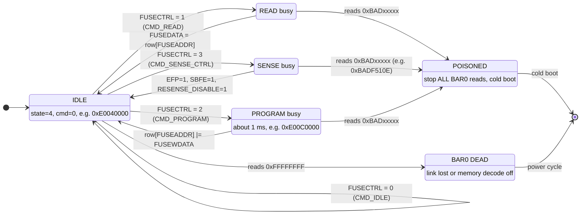
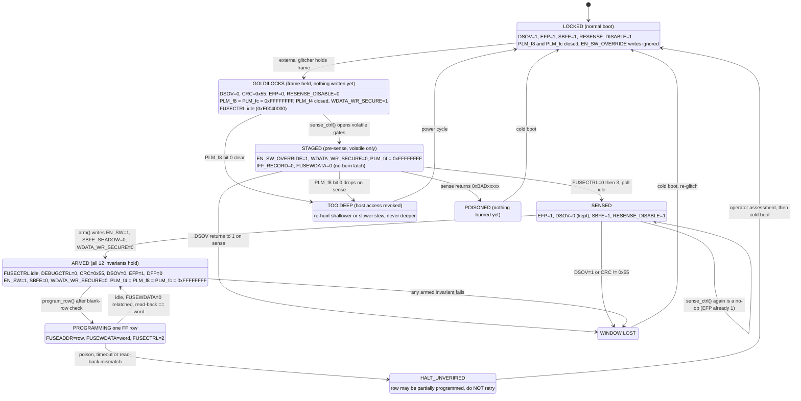
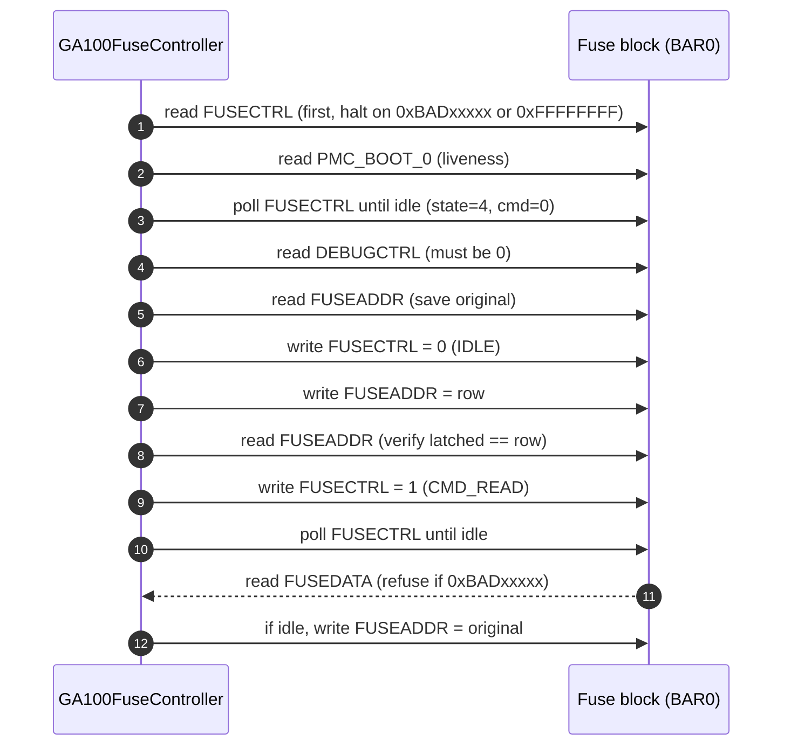
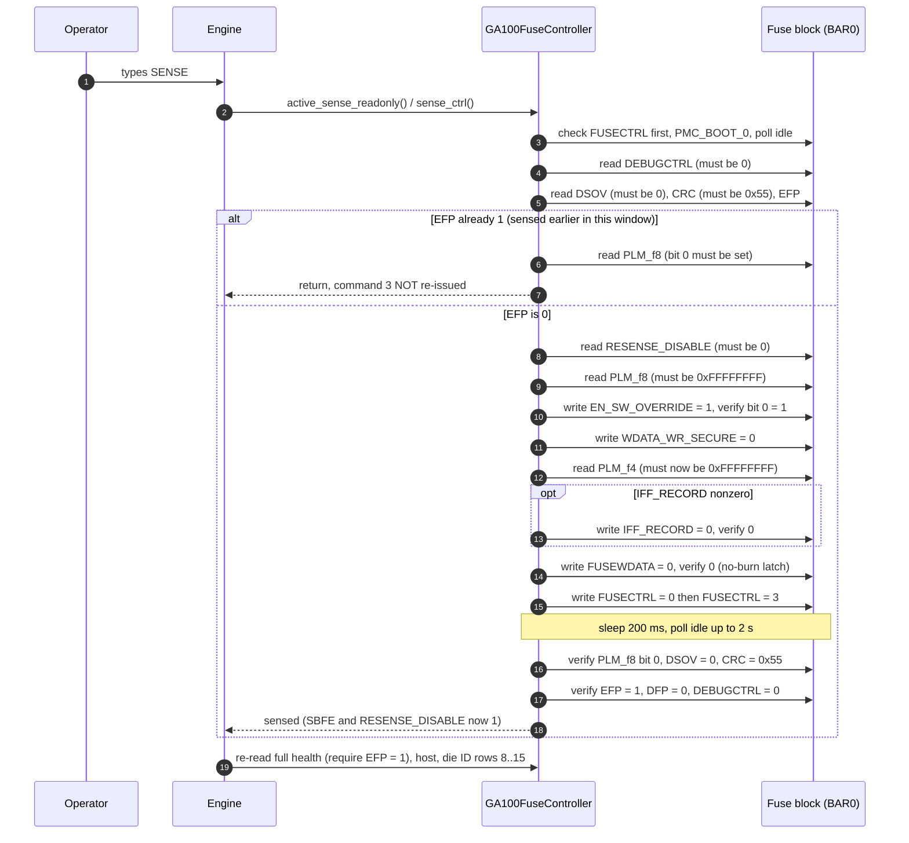
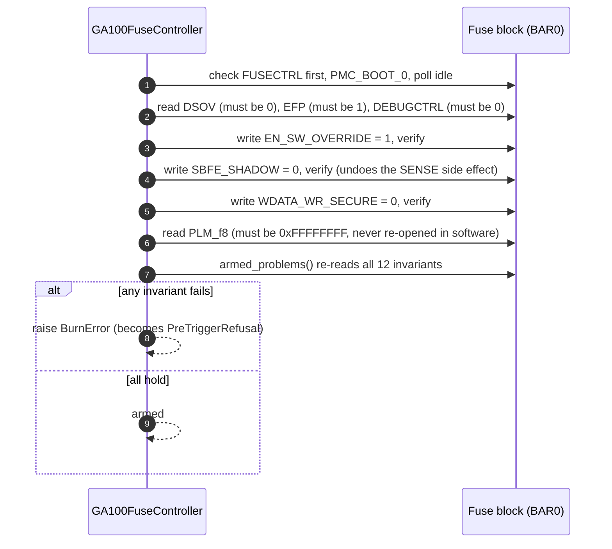
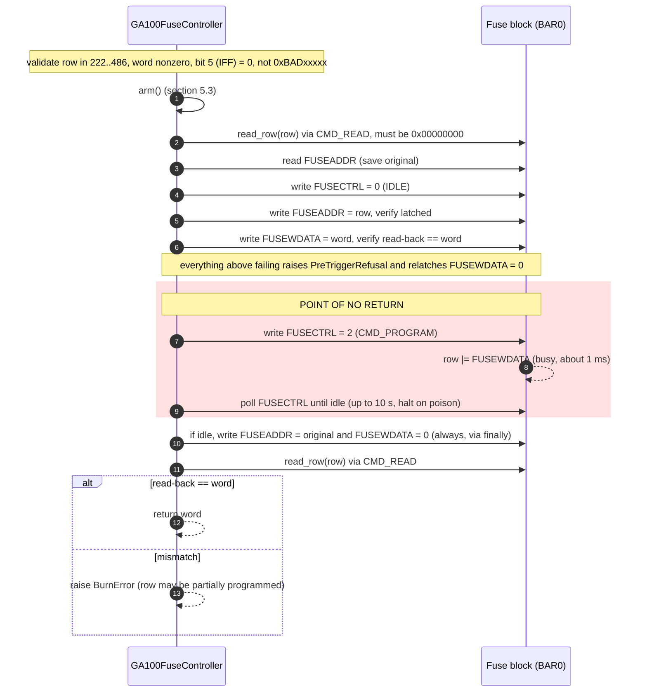
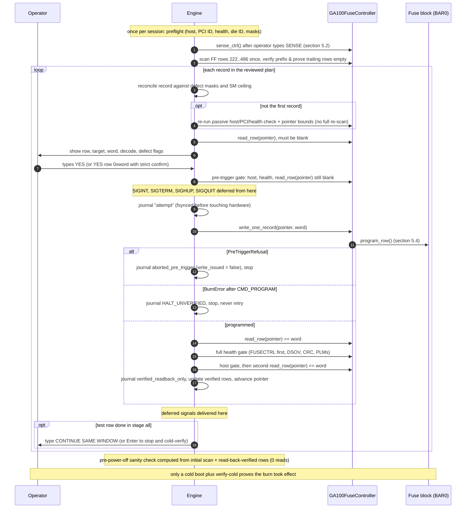
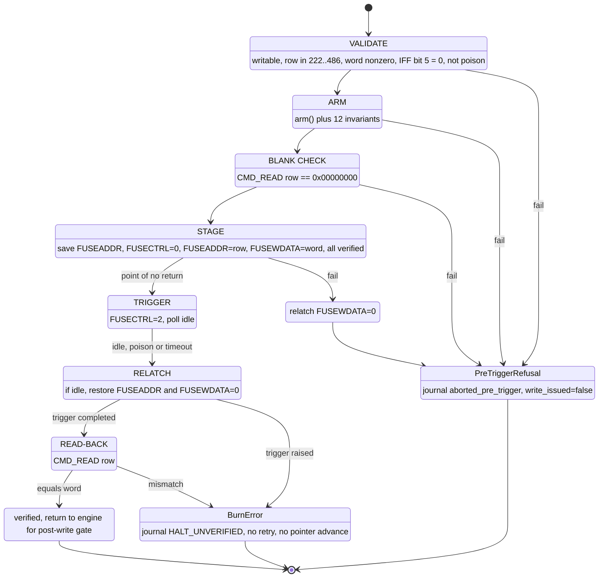

# GA100 Fuse Controller: How It Works

> [!CAUTION]
> This describes the fuse-controller protocol **as implemented by `vfi_burn`** in
> [`vfi_burn/ga100.py`](../vfi_burn/ga100.py) and **as modelled by the offline fake**
> (`FakeGA100MMIO` in [`tests/test_ga100.py`](../tests/test_ga100.py)). It is cross-checked
> against public GA100 VFI research (see the README's *Sources*), but **this codebase has
> never burned a real card**. Fuse programming is irreversible. Treat every statement
> about silicon behaviour below as "what the references report", not as something this
> tool has proven.

This document covers:

1. [Register map](#1-register-map)
2. [The `FUSECTRL` command engine](#2-the-fusectrl-command-engine) (state machine)
3. [The security / window state machine](#3-the-security--window-state-machine) (locked → Goldilocks → sensed → armed)
4. [Why `CMD_PROGRAM` only ever sets bits](#4-otp-semantics-and-the-no-burn-latch) (OTP semantics, the no-burn latch)
5. [Sequences](#5-sequences): `CMD_READ`, `SENSE_CTRL`, `arm()`, `program_row()`, and the full per-record burn loop
6. [`program_row()` failure classes](#6-program_row-internal-state-machine-and-failure-classes) (pre-trigger vs. post-trigger)
7. [Read-only mode write allowlist](#7-read-only-mode-write-allowlist)
8. [Poison and fault handling](#8-poison-and-fault-handling)

---

## 1. Register map

All registers live in BAR0 and are accessed **only** as single aligned 32-bit loads/stores via
[`AlignedMMIO`](../vfi_burn/mmio.py) (`memoryview(mm)[off:off+4].cast("I")`, never `struct.pack_into`).

| Register | BAR0 offset | Dir | Role |
|---|---|---|---|
| `FUSECTRL` | `0x00820000` | RW | Command (`[4:0]`) + state (`[20:16]`). Idle reads `0xE0040000` (state `4`, cmd `0`). |
| `FUSEADDR` | `0x00820004` | RW | Physical fuse row index (`0..511`) for `CMD_READ` / `CMD_PROGRAM`. |
| `FUSEDATA` | `0x00820008` | RO | Output of `CMD_READ`. **Writes are refused** by the controller wrapper. |
| `FUSEWDATA` | `0x0082000C` | RW | Input word for `CMD_PROGRAM`. Only sticks while `PLM_f4` is open. |
| `EN_SW_OVERRIDE` | `0x00820040` | RW | Write `1` to enable shadow-register writes. Sticks only while `DSOV == 0`. |
| `IFF_RECORD` | `0x00820050` | RW | Must be `0` before `SENSE_CTRL`. |
| `DEBUGCTRL` | `0x00820060` | RW | **Never written.** Must read `0`; bit 1 (`RWL`) = 1 would select the RIR macro instead of the main array. |
| `CRC_STATUS` | `0x00820070` | RO | `0x55` = healthy fuse CRC. |
| `EFP_STATUS` | `0x00820078` | RO | `OPT_ENABLE_FUSE_PROGRAM`. `0` in a fresh Goldilocks frame; `SENSE_CTRL` restores it to `1`. |
| `DFP_STATUS` | `0x0082007C` | RO | `OPT_DISABLE_FUSE_PROGRAM`. Must be `0`. |
| `DSOV_STATUS` | `0x00820084` | RO | `OPT_DISABLE_SW_OVERRIDE`. `0` only inside the Goldilocks window. |
| `PLM_f4` | `0x008200F4` | RO | Privilege mask guarding `FUSEWDATA`. Opens to `0xFFFFFFFF` when `WDATA_WR_SECURE = 0`. |
| `PLM_f8` | `0x008200F8` | RO | Privilege mask guarding `FUSECTRL`. Bit 0 = host access. `0xFFFFFFFE` = frame too deep. |
| `PLM_fc` | `0x008200FC` | RO | Privilege mask guarding the FUSEOPT shadows. `0xFFFFFFFF` in Goldilocks. |
| `WDATA_WR_SECURE` | `0x0082048C` | RW | Write `0` to open `PLM_f4`. |
| `CTRL_WR_SECURE` | `0x008205B4` | RW | Could re-open `PLM_f8`. **Deliberately never written**: a closed `PLM_f8` is a diagnostic (frame too deep), not something to paper over. |
| `RESENSE_DISABLE` | `0x00821058` | RO | `0` before `SENSE_CTRL`; becomes `1` after. **One sense per glitch window.** |
| `SBFE_SHADOW` | `0x00821108` | RW | `OPT_SECURED_BURN_FEATURE_ENABLE` shadow. `SENSE_CTRL` sets it to `1`; must be written back to `0` before programming FF rows. |
| `PMC_BOOT_0` | `0x00000000` | RO | Liveness probe (`0` / `0xFFFFFFFF` / poison = BAR0 dead). |

`FUSECTRL` commands:

| Value | Name | Effect |
|---|---|---|
| `0x0` | `CMD_IDLE` | No-op; always written before issuing a real command. |
| `0x1` | `CMD_READ` | `FUSEDATA ← row[FUSEADDR]`. |
| `0x2` | `CMD_PROGRAM` | `row[FUSEADDR] ← row[FUSEADDR] OR FUSEWDATA` (irreversible). Busy for ~1 ms. |
| `0x3` | `CMD_SENSE_CTRL` | Re-senses the control fuses: `EFP 0→1` while keeping `DSOV = 0`. |

Fuse array layout (512 rows × 32 bits): rows `0..221` regular/control/FPF, **rows `222..486` FF records**
(the only rows `vfi_burn` will program), rows `487..511` IFF. Die ID is rows `8..15`. A blank FF row
reads `0x00000000`. See [`vfi_burn/ffrecord.py`](../vfi_burn/ffrecord.py) for the FF record encoding.

---

## 2. The `FUSECTRL` command engine

`FUSECTRL` is a small command processor. Software writes a command into bits `[4:0]`, the unit goes
busy, then returns to **IDLE**, which is defined in code as
[`is_fusectrl_idle()`](../vfi_burn/ga100.py): not poisoned, state field `[20:16] == 4`, command field
`[4:0] == 0`. Every command is bracketed by `poll_idle()` (1 ms poll, timeout `0.2 s` for reads,
`2 s` for sense, `10 s` for program).



Rules the controller wrapper enforces around this engine:

- **`FUSECTRL` is always read first.** [`_check_fusectrl_first()`](../vfi_burn/ga100.py) halts on
  `0xFFFFFFFF` or any `0xBADxxxxx` value *before* any other register is touched.
- **A command is only issued from IDLE**, and always as `FUSECTRL = 0` followed by `FUSECTRL = cmd`.
- **`DEBUGCTRL` must read `0`** before `CMD_READ`, `CMD_SENSE_CTRL` and `CMD_PROGRAM`.
- **`FUSEADDR` is saved and restored** around every read and program, and its latch is verified by
  read-back before triggering.

---

## 3. The security / window state machine

The command engine is always present, but whether `CMD_PROGRAM` actually does anything depends on a
set of *fused option bits* and *privilege masks*. On a normal boot they lock programming out. A
voltage glitch held at the right depth (the **Goldilocks frame**, created by an external glitcher,
never by `vfi_burn`) leaves `DSOV = 0`, which is what lets software re-open the gates.



Key properties of this machine:

- **Everything between `Goldilocks` and `Armed` is volatile.** `EN_SW_OVERRIDE`, `WDATA_WR_SECURE` and
  `SBFE_SHADOW` are shadow registers; a power cycle returns the card to `Locked`. Only the
  `Programming → Armed` edge changes the fuse array.
- **`SENSE_CTRL` is one-shot per window.** After it, `RESENSE_DISABLE = 1`. `sense_ctrl()` is therefore
  idempotent: if `EFP == 1` already, it only re-checks `PLM_f8` and returns without issuing command 3.
  If `EFP == 0` but `RESENSE_DISABLE == 1`, the window is unusable: cold boot and re-glitch.
- **`SENSE_CTRL` sets `SBFE = 1` as a side effect**, which blocks FF programming. That is why `arm()`
  must run *after* sense and write `SBFE_SHADOW = 0`.
- **A closed `PLM_f8` is never re-opened in software.** `CTRL_WR_SECURE` exists, but writing it would
  hide the "frame too deep" signal, so `arm()` refuses instead.
- **The armed state persists across records in the same window.** Multiple records (test row, then
  real records after `CONTINUE SAME WINDOW`) are each programmed from `Armed`. `program_row()` calls
  `arm()` every time, which is idempotent and re-asserts all 12 invariants.

### What gates `CMD_PROGRAM` in hardware

As modelled in `FakeGA100MMIO` (from `kprinssu/ga100-ff-tools` observations), `CMD_PROGRAM` only
modifies the array when **all** of these hold at trigger time:

| Condition | Opened by |
|---|---|
| `EFP_STATUS == 1` | `CMD_SENSE_CTRL` |
| `SBFE_SHADOW == 0` (for FF rows ≥ 222) | `arm()`: `SBFE_SHADOW = 0` (needs `DSOV = 0` and `EN_SW_OVERRIDE = 1`) |
| `PLM_f4 == 0xFFFFFFFF` (`FUSEWDATA` writable) | `WDATA_WR_SECURE = 0` (needs `DSOV = 0` and `EN_SW_OVERRIDE = 1`) |
| `DEBUGCTRL == 0` | Never written; just verified |

`vfi_burn` does not rely on the hardware to refuse. It asserts every one of these itself (plus `CRC`,
`DSOV`, `DFP`, `PLM_f8`, `PLM_fc`) in [`armed_problems()`](../vfi_burn/ga100.py) before staging the word.

---

## 4. OTP semantics and the no-burn latch

Fuses are one-time-programmable: a `CMD_PROGRAM` can only flip bits **0 → 1**. The effect is

```text
row[FUSEADDR] = row[FUSEADDR] | FUSEWDATA
```

Two consequences shape the protocol:

1. **`FUSEWDATA = 0` is a guaranteed no-op program.** Before `SENSE_CTRL` and after every
   `CMD_PROGRAM`, the controller writes `FUSEWDATA = 0` and verifies it (`_relatch_no_burn()`). If a
   stray `CMD_PROGRAM` happens later (another tool, a typo, firmware), it ORs zero into whatever row
   `FUSEADDR` selects and nothing changes.
2. **Only blank rows are targeted.** `program_row()` refuses unless the target row reads
   `0x00000000`. Programming into a non-blank row would OR two records together, which is
   unrecoverable. The engine's slot scan additionally requires all records to be contiguous from
   row 222, so the next free slot is provable rather than guessed.

---

## 5. Sequences

Participants used below:

- **Operator**: the human at the prompt.
- **Engine**: [`process_records()`](../vfi_burn/engine.py) / [`_write_verify_or_halt()`](../vfi_burn/engine.py).
- **Ctl**: [`GA100FuseController`](../vfi_burn/ga100.py) (through `GA100LiveAdapter`).
- **FUSE**: the GA100 fuse block in BAR0.

### 5.1 Reading a row (`read_row`, `CMD_READ`)

Reads are safe and are used everywhere: die ID check, slot scan, blank check, and read-back.



### 5.2 Opening the window (`sense_ctrl`, `CMD_SENSE_CTRL`)

Runs once per Goldilocks window, after the operator types `SENSE`. Allowed even on a read-only
controller because it cannot burn anything (`FUSEWDATA` is latched to `0` first).



Any failed verify raises and the engine journals `preflight_failed`. Typical diagnoses: `PLM_f8` bit 0
collapsed (too deep), `DSOV` back to `1` (window lost), poison (too deep, cold boot).

### 5.3 Arming (`arm`)

Called at the start of every `program_row()`. Requires a writable controller (`--execute`).



### 5.4 Programming one record (`program_row`, `CMD_PROGRAM`)



### 5.5 The full per-record burn loop (engine + controller)

This is how [`process_records()`](../vfi_burn/engine.py) wraps the controller for every record in the
plan. The first record is normally the no-op test row; real records follow in the same window
(after `CONTINUE SAME WINDOW`) or in a later window (`--stage real` with a test receipt).



---

## 6. `program_row()` internal state machine and failure classes

The single most important property of the writer is that it tells the engine **which side of
`CMD_PROGRAM` a failure happened on**. Anything before the trigger is a
[`PreTriggerRefusal`](../vfi_burn/model.py) (nothing can have burned). Anything after is a plain
`BurnError` (the row may be partially programmed).



---

## 7. Read-only mode write allowlist

`GA100LiveAdapter` opens the controller with `read_only=True` unless `--execute` is given. In that mode
[`_wr()`](../vfi_burn/ga100.py) only permits the writes needed for `CMD_READ` and the non-burning
`SENSE_CTRL` path:

| Register | Allowed values (read-only mode) |
|---|---|
| `FUSEADDR` | any |
| `FUSECTRL` | `0` (IDLE), `1` (READ), `3` (SENSE_CTRL). **`2` (PROGRAM) blocked.** |
| `FUSEWDATA` | `0` only |
| `IFF_RECORD` | `0` only |
| `EN_SW_OVERRIDE` | `0`, `1` |
| `WDATA_WR_SECURE` | `0` only |

`SBFE_SHADOW` writes are blocked, so a read-only controller can sense but can never reach `Armed`.
Independent of mode, writes to `DEBUGCTRL` and to the read-only `FUSEDATA` port are always refused,
and [`AlignedMMIO.write32()`](../vfi_burn/mmio.py) separately refuses `DEBUGCTRL` without an explicit
`allow_debugctrl=True` (which the controller never passes).

---

## 8. Poison and fault handling

| Observation | Where detected | Meaning | Action |
|---|---|---|---|
| `FUSECTRL == 0xFFFFFFFF` | `_check_fusectrl_first()` | BAR0 dead / decode off / link lost | Stop; park or power cycle |
| Any `0xBADxxxxx` (`0xBADF...` poison, `0xBAD0...` fuse unit) | every read path | PRI error / fuse unit not answering | Stop all BAR0 reads; cold boot. Before a write: too deep. After a write: assess the row on cold boot |
| `PLM_f8` bit 0 clear (`0xFFFFFFFE`) | health gate, `sense_ctrl()`, `arm()` | Host access revoked: frame too deep | Abort; re-hunt shallower / slower slew, never deeper |
| `DSOV` back to `1` | health gate, after sense | Goldilocks window lost | Cold boot, re-glitch |
| `EFP == 0` but `RESENSE_DISABLE == 1` | `sense_ctrl()` | Sense already consumed, programming not enabled | Cold boot, re-glitch |
| `FUSECTRL` not idle within timeout | `poll_idle()` | Unit hung | Pre-trigger: refuse. Post-trigger: `HALT_UNVERIFIED` |
| Read-back ≠ intended | `program_row()`, engine | Partial or wrong program | `HALT_UNVERIFIED`; do not retry, do not advance |

The guiding rule: automatic decisions only ever resolve toward *not writing*. The
controller never retries a program, never re-issues `SENSE_CTRL` in the same window, and never
"recovers and continues" after poison.
