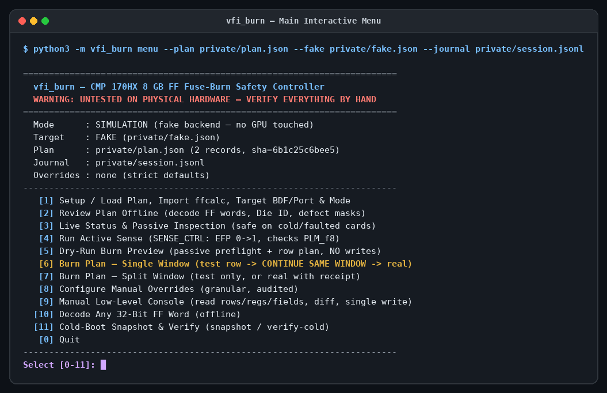
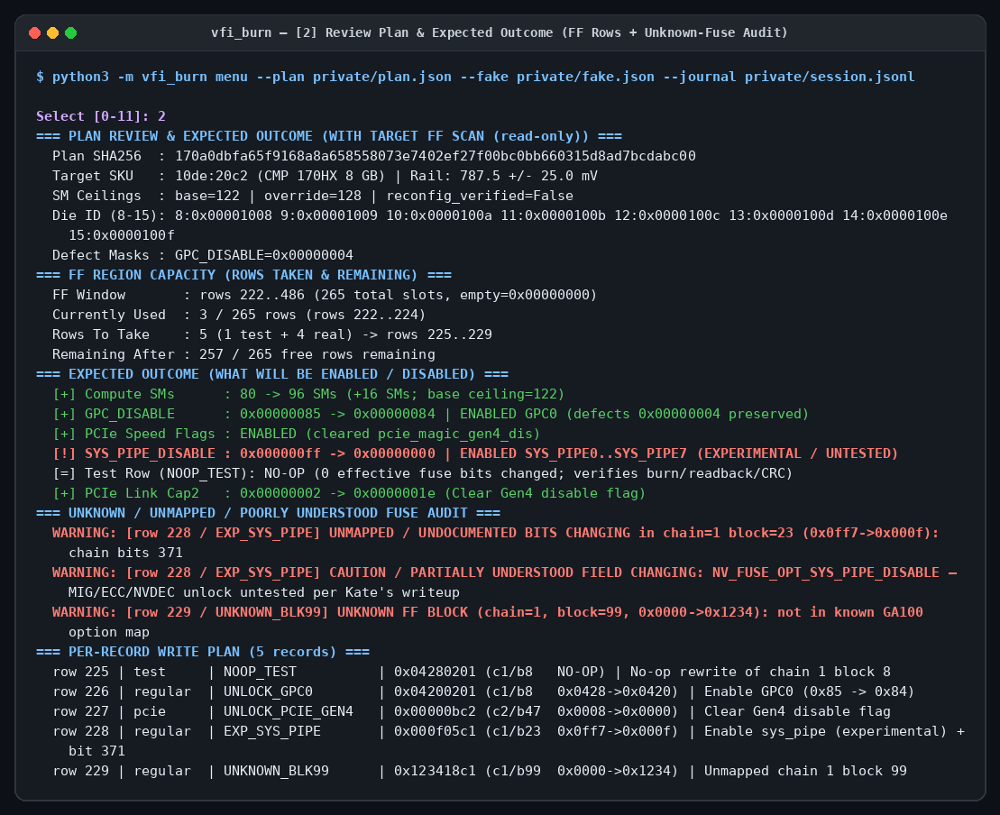
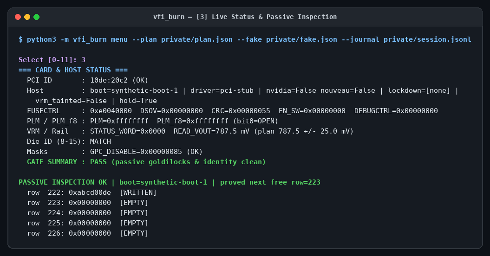
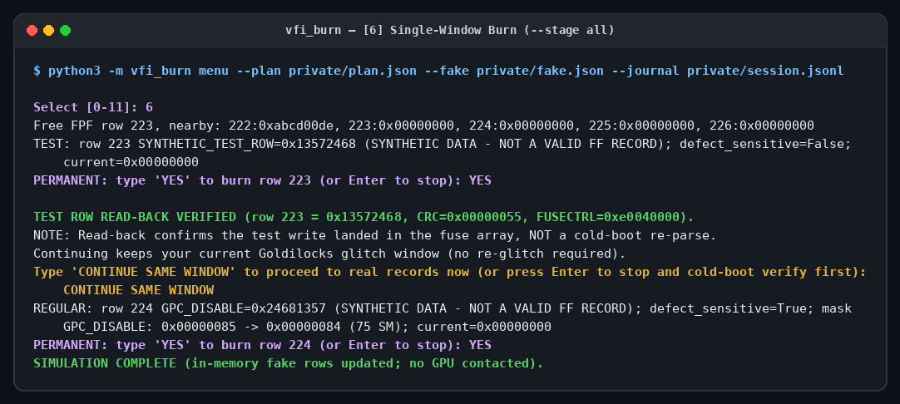
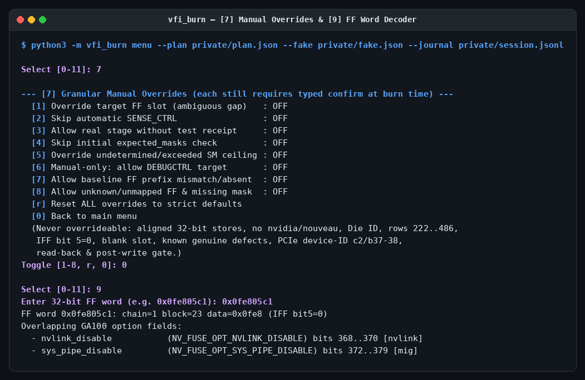
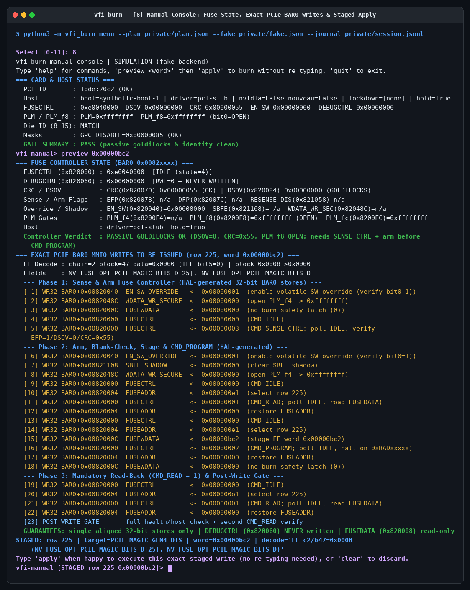

# vfi_burn — Interactive Menu Interface (Recommended for Bench Use)

> [!CAUTION]
> **UNTESTED ON PHYSICAL HARDWARE.** Fuse programming is physically irreversible and the worst-case failure is a permanently bricked card. Read the safety notes in the [README](../README.md) before running any live session.

This page documents the guided, numbered interactive menu. For the scriptable subcommand interface, see [`cmd_line.md`](cmd_line.md).

---

## Launching the Menu

Running `vfi_burn` with **no arguments** (or with `menu` plus optional pre-filled flags) launches a plain numbered main menu designed for SSH/serial/tmux sessions (full scrollback preserved; `[1] Setup -> [a]` opens a kernel `menuconfig`-style `curses` TUI on interactive TTYs with an automatic plain-text fallback):

```bash
# Launch empty menu and configure everything interactively:
python3 -m vfi_burn

# Launch pre-loaded for offline simulation (no GPU touched):
python3 -m vfi_burn menu \
  --plan private/plan.json \
  --fake private/fake.json \
  --journal private/session.jsonl

# Launch pre-loaded for a live bench session (starts in LIVE READ-ONLY / DRY-RUN mode):
sudo python3 -m vfi_burn menu \
  --plan private/plan.json \
  --bdf 0000:05:00.0 \
  --journal private/session.jsonl
```

---

## Safety Behaviour & Menu Options

The menu wraps every CLI workflow with the exact same safety gates, `fsync`ed JSONL journal, and typed confirmations:
- **Safe by default on live hardware**: opens in `LIVE READ-ONLY / DRY-RUN` mode. Physical burns (`[6] Burn Plan`) are refused before opening BAR0 until you explicitly enable Live Execute in `[1] Setup -> [g]` by typing `ENABLE LIVE WRITES` (or pass `--execute`), and switching targets automatically resets Live Execute back to `OFF`.
- **Adaptive `[6] Burn Plan`**: inspects live FPF rows against the plan and automatically picks the right flow:
  - **Fresh card**: burns the no-op test row first, then pauses so you can either continue directly into the real records in the same held glitch session (`CONTINUE SAME WINDOW`) or press Enter to stop, power-cycle, and cold-boot verify first.
  - **Resuming** (test row and/or earlier real records already on the card): shows which rows are already committed and which remain, uses (or prompts for) the cold-boot test receipt, and resumes cleanly from the next unburned record.
  - **Complete**: reports that all planned records are already burned and exits without touching `SENSE_CTRL` or `CMD_PROGRAM`.
- **Full end-to-end bench flow in one place**:

| Option | Action |
|---|---|
| `[1]` | Setup / Configure Unlocks from Card (`[a]` kernel `menuconfig` TUI — unlock/lock GPCs, TPCs, FBPs, PCIe Gen3/Gen4, NVLink, experimental MIG/SYS_PIPE and media engines) / load saved plan (`[b]`) / target & mode |
| `[2]` | Review Plan & Expected Outcome (FF rows taken/remaining, enabled/disabled breakdown, unknown/experimental fuse audit) |
| `[3]` | Live Status & Passive Inspection |
| `[4]` | Active Sense (`SENSE_CTRL`) |
| `[5]` | Passive Dry-Run Preview (adapts to fresh vs. resumed cards) |
| `[6]` | Burn Plan (no-op test first, or resume remaining records) |
| `[7]` | Granular Manual Overrides |
| `[8]` | Manual Low-Level Console |
| `[9]` | Offline FF Word Decoder |
| `[10]` | Cold-Boot Snapshot & Verify |
| `[11]` | Experimental Registers (read-only: ECC, SM speed select, SKU, readouts) |

### Experimental: media engines (NVDEC / NVJPG / OFA)

The `menuconfig` root has an **`[EXPERIMENTAL] Media engines`** submenu with two toggles:

- **NVDEC x5** — clears `NVDEC_DISABLE` (chain 1 bits 139..143, block 8, shared with `FBPA_DISABLE[23:21]` and `GPC_DISABLE`).
- **NVJPG0 + OFA0** — clears chain 1 bits 146 (block 9) and 371 (block 23, shared with `NVLINK_DISABLE` / `SYS_PIPE_DISABLE`) **together**: which bit is NVJPG and which is OFA was never separated.

Positions follow `sayhellotojungle/cmp170hx-ffcalc`. These engines have **no `*_DEFECTIVE` register**, so the genuine-defect audit cannot cover them. A toggle is only offered when:

1. `OPT_*_DISABLE` and `STATUS_OPT_*` were both read (`0x820378/0x820C24`, `0x820370/0x820C0C`, `0x8202D8/0x820E34`) and are equal (ffcalc's zero-defect evidence rule),
2. `OPT_*_DISABLE` agrees with the FF replay, and
3. every block involved is already in the card's FF prefix.

That evidence is weak: ffcalc's own FBP measurement (a5c194c) shows `STATUS_OPT_*` simply following `OPT_DISABLE`. Each burn record that changes engine bits needs a separate typed `REVIEW MEDIA ENGINES` confirmation. After the cold boot, check that `STATUS_OPT_*` reads 0 and the engines enumerate; a unit that stays non-zero is physically absent, so don't re-burn it.

Row cost: if you select the engines in the same plan as compute/NVLink changes, they mostly share records that are being rewritten anyway (about +1 row, for block 9). Adding them after those records are burned costs up to 3 rows and another glitch window.

---

## Walkthrough Screenshots (Offline Simulation Mode)

> All screenshots below were captured offline against synthetic fixtures (no physical GPU contacted).

### 1. Main Menu & Live Status Header


### 2. `[2]` Review Plan & Expected Outcome (Enabled/Disabled, Unknown Fuses, FF Rows Taken & Remaining)
Shows exact FF rows used/taken/remaining, what compute/PCIe/feature units are being enabled or disabled (with defect masks preserved), and flags any unknown FF blocks, unmapped bits, or experimental/untested fields before you ever touch a burn command.


### 3. `[3]` Live Status, Passive Health Gates & Free-Slot Proof


### 4. `[6]` Burn Plan With Post-Test `CONTINUE SAME WINDOW` Checkpoint
On live hardware (`--execute`), each record additionally requires typing the exact row and hex word (`YES <row> <0xword>`), plus `SENSE` before `SENSE_CTRL`.


### 5. `[7]` Granular Manual Overrides & `[9]` Offline 32-Bit FF Word Decoder
See [`cmd_line.md`](cmd_line.md#granular-manual-overrides-no-blanket---force) for the full list of granular overrides and their typed confirmation phrases.


### 6. `[8]` Manual Low-Level Console — Fuse Controller State, Exact PCIe BAR0 Writes & Staged `preview` → `apply`
Run `preview <word>` (or `preview <target> <word> <description>`) to inspect the complete decoded GA100 fuse controller state (`FUSECTRL`, `DEBUGCTRL`, `CRC`, `DSOV`, `EFP/DFP/RESENSE_DIS`, `EN_SW/SBFE/WDATA_WR_SEC`, `PLM_f4/f8/fc`, host hold) and the exact ordered 32-bit aligned PCIe BAR0 MMIO writes — and **stage** that exact write so you simply type `apply` (no arguments, zero risk of re-typing typos; still gated by row/word confirmation & read-back) or `clear` to discard.

